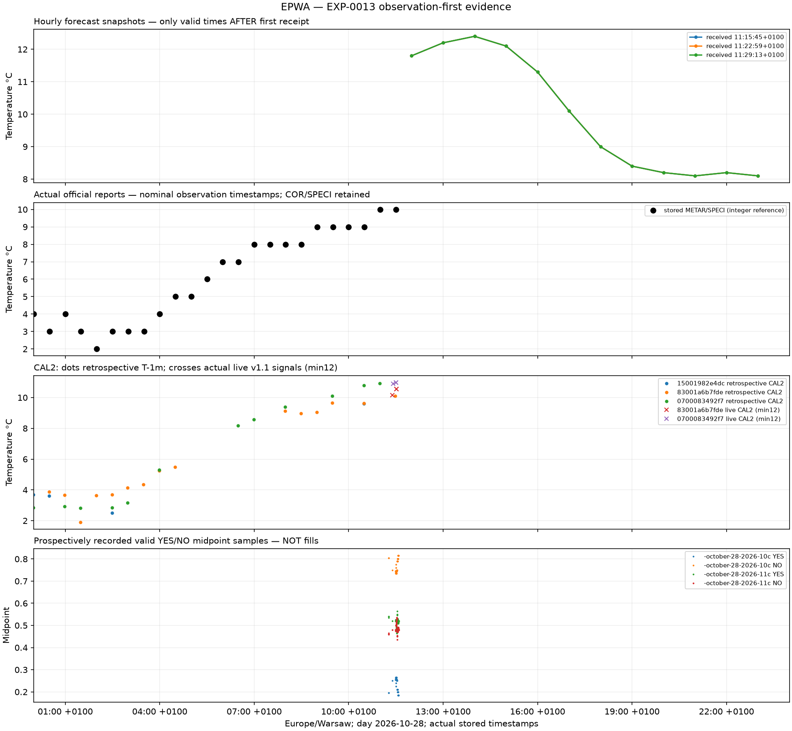

# EXP-0013 — EPWA forecast / PWS / METAR / order-book evidence

Prospective forecast/book capture is distinct from retrospective as-of weather reconstruction. No real orders or changes to either original monitor.

Research snapshot cutoff: **2026-10-28T10:35:35.354440+00:00**. SHA256 weather `748e53c157a9c9e46cacb4af7846e99a600193738e2dee956ab85d0cce0896a7`, research `035c4e72b6d523e445c14f30425d0a72fb8e0fb02b2fbbe5833a91d8db058097`. Separate source snapshots are not assumed simultaneous.

## Actual coverage

Signal analysis uses **EXP0013-v1.1 only**: 524 notifications; 446 prototype/unsupported-version notifications excluded. Original v1 records remain immutable; separate EXCLUSION evidence is exported. Valid raw v1 forecast/book captures remain usable subject to exact station/time/depth filters. Startup METAR_CONTEXT_DISCOVERED is a context notification, not a new official arrival or prior-forecast success.

|Airport|Today's METAR/SPECI/COR identities|Independent routine cycles|Fresh eligible PWS at cutoff|Forecast snapshots|
|---|---:|---:|---:|---:|
|EDDM|24|22|4|3|
|EHAM|23|23|3|3|
|EPWA|24|22|1|3|
|EGLL|21|20|1|3|

Stored book samples: **4026**, valid station-matched fresh binary pairs: **785**. Frozen-window bin analysis: **INSUFFICIENT_DATA**, 2 valid token bins, 0 matched token-bin pairs / 0 condition-bin pairs, 0 market-days. Both outcomes are correlated; ticks are not independent trials.

Excluded bins: `{"INCOMPLETE_BIN_ENDPOINTS": 2, "MISSING_INVALID_STALE_OR_STATION_MISMATCH": 162}`. Conservative continuity additionally requires valid intervening samples, max20s sample gap, same connection, <=10s freshness and endpoint distance. Controls have no declared-window overlap; paired without reuse to nearest control in the same token/local day. Threshold:20market-days and10condition-bin pairs per market.

## EPWA current sensor context

|Sensor|Measurement UTC|First receipt UTC|Raw °C|CAL2 offset °C|Calibrated °C|Next integer|Status|
|---|---|---|---:|---:|---:|---:|---|
|opensensemap:6941429cfdfe0700083492f4:6941429cfdfe0700083492f7|2026-10-28T10:34:32.398000+00:00|2026-10-28T10:35:26.269480+00:00|10.57|-0.2599999999999998|10.83|11|CALIBRATED_RESEARCH_CANDIDATE|

## Latest actual EPWA reports

|Nominal UTC|First received UTC|Temperature °C|Type|COR|
|---|---|---:|---|---|
|2026-10-28T05:00:00+00:00|2026-10-28T05:03:01.550223+00:00|7.0|METAR|False|
|2026-10-28T05:30:00+00:00|2026-10-28T05:32:57.169273+00:00|7.0|METAR|False|
|2026-10-28T06:00:00+00:00|2026-10-28T06:04:20.653729+00:00|8.0|METAR|False|
|2026-10-28T06:30:00+00:00|2026-10-28T06:32:54.603849+00:00|8.0|METAR|False|
|2026-10-28T07:00:00+00:00|2026-10-28T07:02:38.652889+00:00|8.0|METAR|False|
|2026-10-28T07:30:00+00:00|2026-10-28T07:33:00.639013+00:00|8.0|METAR|False|
|2026-10-28T08:00:00+00:00|2026-10-28T08:02:49.932857+00:00|9.0|METAR|False|
|2026-10-28T08:30:00+00:00|2026-10-28T08:32:53.335559+00:00|9.0|METAR|False|
|2026-10-28T09:00:00+00:00|2026-10-28T09:03:20.262502+00:00|9.0|METAR|False|
|2026-10-28T09:30:00+00:00|2026-10-28T09:34:03.047116+00:00|9.0|METAR|False|
|2026-10-28T10:00:00+00:00|2026-10-28T10:03:27.521767+00:00|10.0|METAR|False|
|2026-10-28T10:30:00+00:00|2026-10-28T10:33:32.552342+00:00|10.0|METAR|False|

## Preliminary sensor comparisons — retrospective only

Fixed CAL2 rolling12hours/min12 independently received earlier routine cycles, T-1minute. Raw, calibrated and persistence accuracy share identical target samples. Quantized-reference midpoint offsets retain approximately±0.5C reference ambiguity. No retrospective ranking is activated.

|Airport|Sensor|Cycles|CAL2 correct|Raw correct|Persistence correct|Incremental correct|Incremental harm|Net|
|---|---|---:|---:|---:|---:|---:|---:|---:|
|EDDM|opensensemap:5bce161fbb15b700196e256d:5bce161fbb15b700196e256f|1|0|0|0|0|0|0|
|EDDM|opensensemap:5c755e5d7dea1400190366e8:5c755e5d7dea1400190366ea|17|1|0|9|1|9|-8|
|EDDM|opensensemap:65c13f99e9153000077c4d83:65c13f99e9153000077c4d86|17|2|2|9|1|8|-7|
|EPWA|opensensemap:5c6e9151154515001982e4da:5c6e9151154515001982e4dc|4|1|0|2|0|1|-1|
|EPWA|opensensemap:5d6145ec953683001a6b7fdb:5d6145ec953683001a6b7fde|15|4|3|7|3|6|-3|
|EPWA|opensensemap:6941429cfdfe0700083492f4:6941429cfdfe0700083492f7|12|3|5|6|2|5|-3|
|EGLL|opensensemap:5e61c1cc6cc61f001c6e4086:5e61c1cc6cc61f001c6e4089|13|3|3|4|1|2|-1|
|EGLL|opensensemap:626030a418aca4001ca27240:626030a418aca4001ca27243|12|6|2|4|3|1|2|

## Prospective signal examples

The signal is an immutable observation notification, not a trade. Original weather receipt can precede signal creation; startup discoveries cannot become backdated signals. Unmatched outcomes/false alarms remain PENDING rather than fabricated successes.

|Signal created UTC|Kind|Airport|Available evidence|
|---|---|---|---|
|2026-10-28T10:32:23.683650+00:00|ORDERBOOK_REPRICING_DETECTED|EPWA|{"after": {"ask_size": "20", "asks": [{"price": "0.8", "size": "20"}, {"price": "0.81", "size": "5"}, {"price": "0.82", "size": "25"}, {"price": "0.83", "size": "5"}, {"price": "0.88", "size": "27"}, {"price": "0.89", "size": "36.36"}, {"price": "0.9…|
|2026-10-28T10:32:23.688149+00:00|ORDERBOOK_REPRICING_DETECTED|EPWA|{"after": {"ask_size": "10", "asks": [{"price": "0.62", "size": "10"}, {"price": "0.67", "size": "37.19"}, {"price": "0.68", "size": "2.74"}, {"price": "0.69", "size": "6"}, {"price": "0.7", "size": "21.66"}, {"price": "0.72", "size": "7.14"}, {"pric…|
|2026-10-28T10:32:23.969603+00:00|ORDERBOOK_REPRICING_DETECTED|EPWA|{"after": {"ask_size": "20", "asks": [{"price": "0.8", "size": "20"}, {"price": "0.81", "size": "25"}, {"price": "0.82", "size": "25"}, {"price": "0.83", "size": "5"}, {"price": "0.89", "size": "36.36"}, {"price": "0.98", "size": "10"}, {"price": "0.…|
|2026-10-28T10:32:23.970604+00:00|ORDERBOOK_REPRICING_DETECTED|EPWA|{"after": {"ask_size": "5", "asks": [{"price": "0.33", "size": "5"}, {"price": "0.61", "size": "55.75"}, {"price": "0.66", "size": "10"}, {"price": "0.68", "size": "2.74"}, {"price": "0.69", "size": "6"}, {"price": "0.7", "size": "21.66"}, {"price": …|
|2026-10-28T10:32:43.765113+00:00|PWS_MEASUREMENT_RECEIVED|EDDM|{"airport": "EDDM", "calibration_status": "STORED_CAUSAL_CONTEXT_ONLY_CAL2_NOT_CERTIFIED", "disagreement_raw_c": -0.8199999999999985, "forecast": {"temperature_c": 10.7, "valid_time": "2026-10-28T10:00:00+00:00"}, "raw_integer": 10, "reading": {"firs…|
|2026-10-28T10:32:43.770126+00:00|PWS_MEASUREMENT_RECEIVED|EDDM|{"airport": "EDDM", "calibration_status": "STORED_CAUSAL_CONTEXT_ONLY_CAL2_NOT_CERTIFIED", "disagreement_raw_c": -0.46999999999999886, "forecast": {"temperature_c": 10.7, "valid_time": "2026-10-28T10:00:00+00:00"}, "raw_integer": 10, "reading": {"fir…|
|2026-10-28T10:33:13.589592+00:00|PWS_MEASUREMENT_RECEIVED|EHAM|{"airport": "EHAM", "calibration_status": "STORED_CAUSAL_CONTEXT_ONLY_CAL2_NOT_CERTIFIED", "disagreement_raw_c": 0.9799999999999986, "forecast": {"temperature_c": 13.3, "valid_time": "2026-10-28T10:00:00+00:00"}, "raw_integer": 14, "reading": {"first…|
|2026-10-28T10:33:13.795031+00:00|PWS_MEASUREMENT_RECEIVED|EGLL|{"airport": "EGLL", "calibration_status": "STORED_CAUSAL_CONTEXT_ONLY_CAL2_NOT_CERTIFIED", "disagreement_raw_c": 0.9699999999999989, "forecast": {"temperature_c": 11.8, "valid_time": "2026-10-28T10:00:00+00:00"}, "raw_integer": 13, "reading": {"first…|
|2026-10-28T10:33:13.797032+00:00|PWS_CONFIRMS_DOWNWARD_TRANSITION|EGLL|{"airport": "EGLL", "availability_cutoff": "2026-10-28T10:33:13.334068+00:00", "boundary_distance_c": 0.02499999999999858, "calibrated_temperature_c": 13.524999999999999, "calibration": {"calibration_kind": "QUANTIZED_REFERENCE_MIDPOINT_ESTIMATE", "c…|
|2026-10-28T10:33:13.798031+00:00|PWS_DISAGREES_WITH_FORECAST|EGLL|{"airport": "EGLL", "availability_cutoff": "2026-10-28T10:33:13.334068+00:00", "boundary_distance_c": 0.02499999999999858, "calibrated_temperature_c": 13.524999999999999, "calibration": {"calibration_kind": "QUANTIZED_REFERENCE_MIDPOINT_ESTIMATE", "c…|
|2026-10-28T10:33:44.398716+00:00|PWS_MEASUREMENT_RECEIVED|EHAM|{"airport": "EHAM", "calibration_status": "STORED_CAUSAL_CONTEXT_ONLY_CAL2_NOT_CERTIFIED", "disagreement_raw_c": 0.16000000000000014, "forecast": {"temperature_c": 13.3, "valid_time": "2026-10-28T10:00:00+00:00"}, "raw_integer": 13, "reading": {"firs…|
|2026-10-28T10:33:44.682343+00:00|PWS_MEASUREMENT_RECEIVED|EDDM|{"airport": "EDDM", "calibration_status": "STORED_CAUSAL_CONTEXT_ONLY_CAL2_NOT_CERTIFIED", "disagreement_raw_c": 1.4000000000000004, "forecast": {"temperature_c": 10.7, "valid_time": "2026-10-28T10:00:00+00:00"}, "raw_integer": 12, "reading": {"first…|
|2026-10-28T10:33:44.684844+00:00|PWS_CONFIRMS_DOWNWARD_TRANSITION|EDDM|{"airport": "EDDM", "availability_cutoff": "2026-10-28T10:33:43.658330+00:00", "boundary_distance_c": 0.4499999999999993, "calibrated_temperature_c": 9.05, "calibration": {"calibration_kind": "QUANTIZED_REFERENCE_MIDPOINT_ESTIMATE", "calibration_n": …|
|2026-10-28T10:33:44.686853+00:00|PWS_DISAGREES_WITH_FORECAST|EDDM|{"airport": "EDDM", "availability_cutoff": "2026-10-28T10:33:43.658330+00:00", "boundary_distance_c": 0.4499999999999993, "calibrated_temperature_c": 9.05, "calibration": {"calibration_kind": "QUANTIZED_REFERENCE_MIDPOINT_ESTIMATE", "calibration_n": …|
|2026-10-28T10:34:13.674167+00:00|METAR_UPDATE_RECEIVED|EPWA|{"airport": "EPWA", "forecast": {"temperature_c": 11.0, "valid_time": "2026-10-28T10:00:00+00:00"}, "notification_semantics": "POLL_DISCOVERY_AFTER_ORIGINAL_FIRST_RECEIPT", "prior_available_forecast_received": "2026-10-28T10:29:13.811856+00:00", "rep…|

## Recorded weather / market chronology

Exploratory event window: nominal−10minutes through first receipt+5minutes. These are threshold movements we recorded, not proof of the first market reaction or its cause. Exact station/local contract date and prior watchlist identity are required; future metadata is never used.

|Airport|METAR nominal UTC|First METAR receipt UTC|Recorded repricing UTC|Midpoint before→after|Seconds relative to receipt|
|---|---|---|---|---|---:|
|EPWA|2026-10-28T10:30:00+00:00|2026-10-28T10:33:32.552342+00:00|2026-10-28T10:29:28.432555+00:00|0.735→0.785|-244.120|
|EPWA|2026-10-28T10:30:00+00:00|2026-10-28T10:33:32.552342+00:00|2026-10-28T10:29:28.433555+00:00|0.265→0.215|-244.119|
|EPWA|2026-10-28T10:30:00+00:00|2026-10-28T10:33:32.552342+00:00|2026-10-28T10:29:40.830503+00:00|0.75→0.785|-231.722|
|EPWA|2026-10-28T10:30:00+00:00|2026-10-28T10:33:32.552342+00:00|2026-10-28T10:29:40.832015+00:00|0.25→0.215|-231.720|
|EPWA|2026-10-28T10:30:00+00:00|2026-10-28T10:33:32.552342+00:00|2026-10-28T10:29:40.851015+00:00|0.78→0.745|-231.701|
|EPWA|2026-10-28T10:30:00+00:00|2026-10-28T10:33:32.552342+00:00|2026-10-28T10:29:40.852016+00:00|0.22→0.255|-231.700|
|EPWA|2026-10-28T10:30:00+00:00|2026-10-28T10:33:32.552342+00:00|2026-10-28T10:29:41.072361+00:00|0.745→0.78|-231.480|
|EPWA|2026-10-28T10:30:00+00:00|2026-10-28T10:33:32.552342+00:00|2026-10-28T10:29:41.073361+00:00|0.255→0.22|-231.479|

## Actual prospective CAL2 outcomes

Validated v1.1 confirmation signals: **17**, across **4 distinct airport/target cycles**, of which **1 have matched initial outcomes**. Counts: `{"EXP_A_matched": 2, "EXP_B_matched": 2, "correct": 1, "incremental_correct": 0, "incremental_harm": 3, "matched_initial_outcomes": 4, "pending_signals": 13, "persistence_correct": 4}`. Multiple sensors/receipts/checkpoints for the same target are correlated. A PWS_DISAGREES duplicate notification does not create another prediction count. Unsettled signals are PENDING; corrections remain separate records.
EXP_A/B outcome labels below describe SIGNAL CREATION before/after nominal observation. They do not imply a newly received post-nominal measurement: original PWS receipt is retained separately. A post-nominal signal using an earlier receipt is not evidence of new post-observation data.

|Airport|Signal created UTC|Target UTC|Predicted|Actual|Persistence correct|PWS correct|Lead seconds|Experiment|
|---|---|---|---:|---:|---|---|---:|---|
|EPWA|2026-10-28T10:23:28.503310+00:00|2026-10-28T10:30:00+00:00|10|10.0|True|True|604.049032|EXP_A|
|EPWA|2026-10-28T10:24:28.539285+00:00|2026-10-28T10:30:00+00:00|11|10.0|True|False|544.013057|EXP_A|
|EPWA|2026-10-28T10:30:13.271165+00:00|2026-10-28T10:30:00+00:00|11|10.0|True|False|199.281177|EXP_B|
|EPWA|2026-10-28T10:31:13.320819+00:00|2026-10-28T10:30:00+00:00|11|10.0|True|False|139.231523|EXP_B|

## Eight research answers

1. Open-Meteo explicit ICON model snapshots are implemented with actual first receipt and hourly valid times. Model metadata supplies candidate initialization/availability clocks; association with a returned forecast is not certified. Forecast publication/run remain NULL. See EXP0013_SOURCES.md; one provider capture does not prove it is fastest or most accurate.
2. Weathercloud coordinate candidates are not verified hardware identities or authorized machine-readable measurements. UNKNOWN until owner-supported access is established. No scraping/upload endpoint used as a read API.
3. Per-sensor matched counts above document exploratory T-1m agreement and failures. Multiple sensor search, short coverage and no frozen selected prospective winner prevent a robust most-consistent-sensor claim.
4. Window versus control price movement: **INSUFFICIENT_DATA**; 0 matched condition-bin pairs/0 market-days. Mean token-pair difference `None` is descriptive only.
5. Repricing relative to first METAR receipt remains INSUFFICIENT_DATA until matched same-contract complete weather/book events exist. Nominal report time is not publication time; notification creation is not original receipt.
6. PWS beyond prior hourly forecast: 0 reconstructed sensor-target rows have a genuinely previously received forecast point. Multiple rows are not independent cycles. No incremental prospective edge is established.
7. 785 fresh station-matched binary book samples were recorded. Displayed direct asks and complementary1-bid quotes are exported separately; matching priority, costs, settlement identity and depth constraints block guaranteed fill claims. **No simulated or real economic fills are inferred.**
8. Freeze v1 observation rule: future-only forecast integer transition±10m, complete-day predicted hourly Tmax±60m, scheduled METAR±3m; retain outside controls. A fresh<=300s verified individual sensor may produce a research confirmation only after CAL2rolling12h/min12 and previous-receipt checks; target already received blocks prospective classification. Preserve exact inputs and all false alarms. No trading activation.

## Limits and artifacts

Clock offset remains UNKNOWN. Integer METAR daily maxima do not certify official settlement daily Tmax. LondonCity/EGLC contracts are excluded from Heathrow/EGLL station-matched comparisons. Forecast curves include only points valid after receipt; no historical forecast has been manufactured from today's run. CAL2 diagram dots are retrospective reconstructions; crosses are actual recorded v1.1 confirmation signals. Stored production-calibration context is not certified as CAL2 and is not plotted as such. Missing book samples and gaps remain missing.

CSV files: forecast_weather_metar_timeline.csv, forecast_sensor_reconstruction.csv, forecast_shadow_signals.csv, forecast_shadow_outcomes.csv, forecast_exclusion_audit.csv, forecast_window_bins.csv, forecast_matched_controls.csv, forecast_observed_book_opportunities.csv. Full four-airport counts, exclusions and inputs: forecast_integrated_summary.json.

